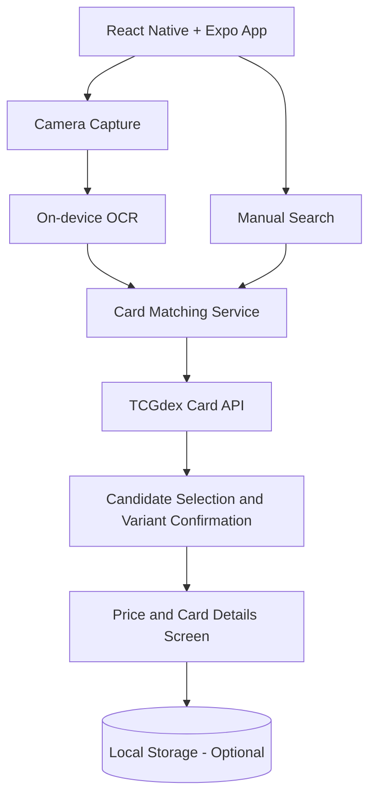

# PokeWorth — High-Level Plan & Simple Architecture

**Project:** `pokeworth`  
**Platform:** iOS + Android  
**Stack:** React Native, Expo, TypeScript  
**Stage:** MVP  
**Approach:** Free-first, local processing where practical, minimal infrastructure

## 1. Product Vision

Build a mobile app that lets users photograph an **English Pokémon trading card**, identify its exact print, and view an estimated market price.

**Main user journey:**

1. Open the app and tap **Scan Card**.
2. Photograph the card.
3. Extract the card name and collector number with on-device OCR.
4. Search a Pokémon card catalog for matching candidates.
5. Confirm the correct set and variant if needed.
6. Display the card image, details, and available market price.

> A price is an estimate, not a guaranteed resale value. It depends on the exact printing, condition, language, grading, and availability of market data.

## 2. MVP Scope

| Feature | Description | Priority |
|---|---|---|
| Card camera | Photograph a Pokémon card | P0 |
| On-device OCR | Read card name and collector number | P0 |
| Card matching | Find candidates by name, number, and set | P0 |
| Match confirmation | Select exact card and variant when uncertain | P0 |
| Market price | Show available price, currency, provider, and timestamp | P0 |
| Manual search | Find cards without the camera | P0 |
| Recent scans | Save scan history locally | P1 |
| Collection | Save owned cards and quantities | P1 |
| Collection total | Sum available estimates for saved cards | P1 |

**Out of scope for v1:** accounts, cloud sync, payments, marketplaces, price alerts, graded-card appraisal, and advanced computer vision training.

## 3. Simple Architecture



### Responsibilities

- **React Native app:** camera, navigation, results, manual search, and optional collection UI.
- **On-device OCR:** extract text from the card image without uploading photos to a server.
- **Card matching service:** normalize OCR text and rank possible matches by name, collector number, and set.
- **TCGdex API:** supply Pokémon card metadata, images, and pricing where available.
- **Local storage:** optionally store history, favorites, owned cards, and quantities.

**Architecture decision:** Start with **one mobile application and no custom backend**. Introduce a backend later only if needed for API-key protection, aggregation of more pricing sources, shared accounts, or higher-quality AI recognition.

## 4. Technology Stack

| Area | Suggested Technology |
|---|---|
| Mobile | React Native + Expo + TypeScript |
| Navigation | Expo Router |
| Camera | `expo-camera` |
| OCR | `expo-text-extractor` or another compatible native OCR module |
| Cards/prices | TCGdex REST API |
| API state/cache | TanStack Query |
| Small app state | Zustand (only if needed) |
| Local storage | AsyncStorage; SQLite if collection needs grow |

**Build note:** Native OCR libraries generally require an **Expo development build**, not just Expo Go. Validate compatibility with the selected Expo SDK before implementation.

**Price-data note:** Do not assume every card or variant has a current price. Handle missing prices explicitly, show the provider and currency, and avoid claiming precision the data does not support.

## 5. Card Identification Logic

1. Run OCR over the image and extract candidate strings.
2. Parse recognizable elements: card name, collector number (e.g. `4/102`), and possibly set text.
3. Normalize case, spacing, punctuation, and OCR errors.
4. Query the card catalog for candidate records.
5. Score candidates using number, card name, and set agreement.
6. If the result is ambiguous, show 2–5 candidates for manual selection.
7. Ask the user to confirm relevant variants (normal, holo, reverse holo, etc.) whenever the catalog or photo cannot reliably distinguish them.
8. Display the corresponding available market-price estimate.

**Rule:** Never silently treat a low-confidence match as the exact card.

## 6. Proposed Screens

1. **Home:** prominent Scan Card button and manual search entry.
2. **Camera:** card alignment guide and capture action.
3. **Confirm Card:** list of possible matches, including card images and set names.
4. **Card Result:** image, name, set, number, variant, price, currency, source, and updated-at time.
5. **My Collection (P1):** saved cards, quantities, and estimated total value.

## 7. Suggested Repository Structure

```text
pokeworth/
├── app/
│   ├── index.tsx
│   ├── scan.tsx
│   ├── confirm.tsx
│   ├── result.tsx
│   └── collection.tsx
├── src/
│   ├── components/
│   ├── services/
│   │   ├── ocr.service.ts
│   │   ├── card-matcher.service.ts
│   │   ├── tcgdex.service.ts
│   │   └── storage.service.ts
│   ├── hooks/
│   ├── types/
│   └── utils/
├── assets/
└── package.json
```

Keep integrations behind small service interfaces, so OCR or the card/price provider can be replaced later without rewriting screens.

## 8. Development Phases

### Phase 1 — Working Scan
- Initialize Expo + TypeScript project.
- Implement camera capture.
- Integrate OCR and display extracted text for debugging.
- Validate on real Android and iOS devices.

### Phase 2 — Identification & Pricing
- Integrate TCGdex card search.
- Implement candidate ranking and confirmation.
- Handle variants and missing prices.
- Display a polished card details/result screen.
- Add manual search as a fallback.

### Phase 3 — MVP Hardening
- Add loading, empty, error, and retry states.
- Test photos with glare, blur, angled cards, and different backgrounds.
- Check duplicate names across sets and print variants.
- Cache requests to reduce repeated lookups.
- Validate performance and accessibility.

### Phase 4 — Optional Collection
- Save scans locally.
- Track card quantities.
- Show total estimated collection value and highlight cards without current price data.

## 9. MVP Acceptance Criteria

- User can photograph a real English Pokémon card on iOS or Android.
- OCR detects useful text on a representative sample of cards.
- App suggests plausible card matches and allows corrections.
- App distinguishes or asks for the correct set/printing before pricing.
- Card details screen displays the available price with its source, currency, and freshness—or clearly indicates that price is unavailable.
- Manual lookup works if OCR fails.
- Core flow works without a custom backend or user login.

## 10. Future Enhancements

- Scan multiple cards in one image.
- Image-embedding-based recognition if text matching is insufficient.
- Currency conversion to ILS.
- Compare multiple market-price providers.
- Price history and alerts.
- Cloud collection synchronization.
- Graded/ungraded and condition-specific estimates (with reliable data).

---

**First implementation milestone:** `Camera → OCR → Matching → User Confirmation → Card Price`.

**Key principle:** Keep v1 simple, make identification reliable, and never invent a price when market data is unavailable.
